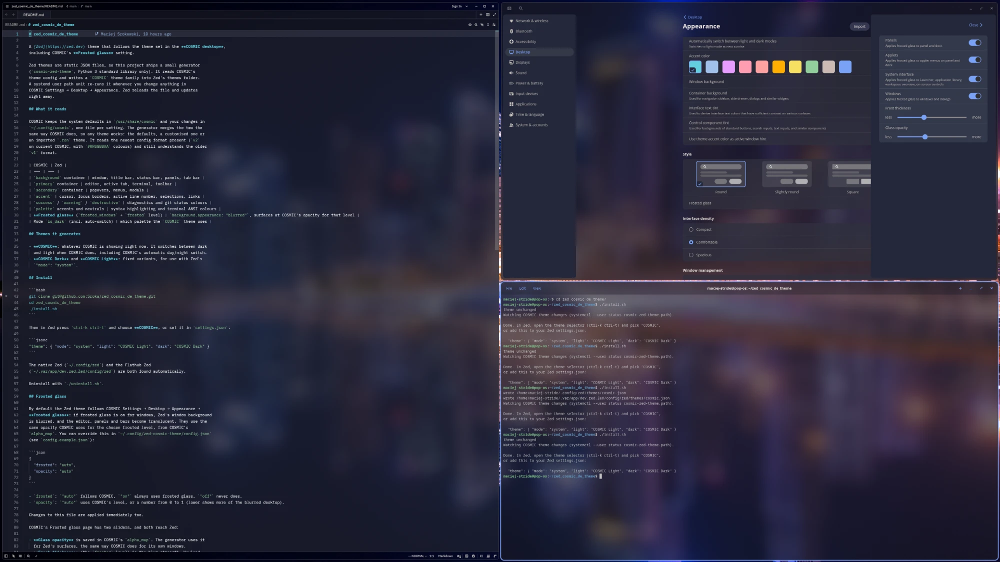
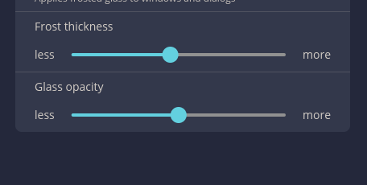

# zed_cosmic_de_theme

A [Zed](https://zed.dev) theme that follows the theme set in the **COSMIC desktop**,
including COSMIC's **Frosted glass** setting.



*Zed (left) using the generated COSMIC theme with frosted glass, next to
COSMIC Settings → Appearance and COSMIC Terminal.*

Zed themes are static JSON files, so this project ships a small generator
(`cosmic-zed-theme`, Python 3 standard library only). It reads COSMIC's
theme config and writes a `COSMIC` theme family into Zed's themes folder.
A systemd user path unit re-runs it whenever you change anything in
COSMIC Settings → Desktop → Appearance. Zed reloads the file and updates
right away.

## What it reads

COSMIC keeps the system defaults in `/usr/share/cosmic` and your changes in
`~/.config/cosmic`, one file per setting. The generator merges the two the
same way COSMIC does, so any theme works: the defaults, a customised one or
an imported `.ron` theme. It reads the newest config format present (`v2`
on current COSMIC, with `#RRGGBBAA` colours) and still understands the older
`v1` format.

| COSMIC | Zed |
| --- | --- |
| `background` container | window, title bar, status bar, panels, tab bar |
| `primary` container | editor, active tab, terminal, toolbar |
| `secondary` container | popovers, menus, modals |
| `accent` | cursor, focus borders, active line number, selections, links |
| `success` / `warning` / `destructive` | diagnostics and git status colours |
| `palette` accents and neutrals | syntax highlighting and terminal ANSI colours |
| **Frosted glass** (`frosted_windows` + `frosted` level) | `background.appearance: "blurred"`, surfaces at COSMIC's opacity for that level |
| Mode `is_dark` (incl. auto-switch) | which palette the `COSMIC` theme uses |

## Themes it generates

- **COSMIC**: whatever COSMIC is showing right now. It switches between dark
  and light when COSMIC does, including COSMIC's automatic day/night switch.
- **COSMIC Dark** and **COSMIC Light**: fixed variants, for use with Zed's
  `"mode": "system"`.

## Install

```bash
git clone git@github.com:Sroka/zed_cosmic_de_theme.git
cd zed_cosmic_de_theme
./install.sh
```

Then in Zed press `ctrl-k ctrl-t` and choose **COSMIC**, or set it in `settings.json`:

```jsonc
"theme": { "mode": "system", "light": "COSMIC Light", "dark": "COSMIC Dark" }
```

The native Zed (`~/.config/zed`) and the Flathub Zed
(`~/.var/app/dev.zed.Zed/config/zed`) are both found automatically.

Uninstall with `./uninstall.sh`.

## Frosted glass

By default the Zed theme follows COSMIC Settings → Desktop → Appearance →
**Frosted glass**: if frosted glass is on for windows, Zed's window background
is blurred, and the editor, panels and bars become translucent. They use the
same opacity COSMIC uses for the chosen frosted level, from COSMIC's
`alpha_map`. You can override this in `~/.config/zed-cosmic-theme/config.json`
(see `config.example.json`):

```json
{
  "frosted": "auto",
  "opacity": "auto"
}
```

- `frosted`: `"auto"` follows COSMIC, `"on"` always uses frosted glass, `"off"` never does.
- `opacity`: `"auto"` uses COSMIC's level, or a number from 0 to 1 (lower shows more of the blurred desktop).

Changes to this file are applied immediately too.

COSMIC's Frosted glass page has two sliders, and both reach Zed:



- **Glass opacity** is saved in COSMIC's `alpha_map`. The generator uses it
  for Zed's surfaces, the same way COSMIC does for its own windows.
- **Frost thickness** (the `frosted` level) is the blur strength. Wayland
  apps can only ask the compositor to blur behind them; they can't set the
  strength. The compositor blurs every window that asks with your Frost
  thickness. Moving the slider also picks a different `alpha_map` entry, so
  Zed's opacity follows it, just as COSMIC's own windows do.

### Blur needs a recent Zed

COSMIC's compositor only offers the standard `ext-background-effect-v1` blur
protocol. Zed releases up to 1.27 only speak the older KDE protocol
(`org_kde_kwin_blur`), so on COSMIC they are translucent but **not blurred**.
Zed switched to `ext-background-effect-v1` in
[zed-industries/zed#53746](https://github.com/zed-industries/zed/pull/53746)
(merged 30 October 2026). Releases built after that get COSMIC's real frost.

Until then, a sharp wallpaper behind a see-through editor can be hard to read.
Set a higher `opacity` (for example `0.92`) in the config file, or
`"frosted": "off"`, and change it back after updating Zed.

## Manual use

```bash
cosmic-zed-theme                 # generate once
cosmic-zed-theme --watch         # keep running without systemd
cosmic-zed-theme --frosted on --opacity 0.7
cosmic-zed-theme --stdout        # print the theme JSON
cosmic-zed-theme -o ~/somewhere  # write to a specific themes folder
```

## License

MIT
